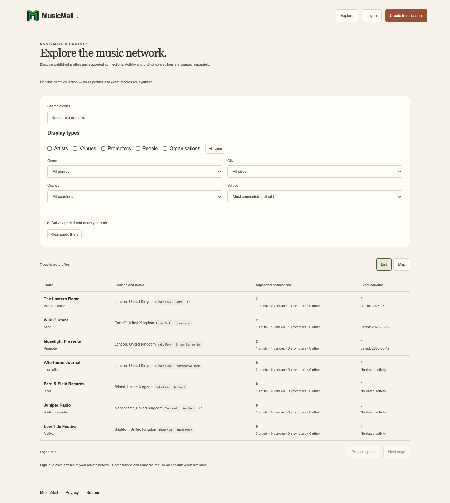

# MusicMail

MusicMail is a web application for independent musicians to discover industry
contacts, organise a private professional network, plan events and manage
follow-ups. It includes an optional Gmail sending integration.

**Next.js · React · TypeScript · PostgreSQL · Supabase · Vitest · Playwright**

## Engineering milestone — Phase 1: upgrade safety

The challenge was to extend a working application while preserving existing
accounts, private CRM records and established workflows.

I consolidated the next application version, documented the deployed baseline,
and added repeatable database upgrade rehearsals using synthetic data. Tests
check existing account access, stable references, saved filters, event records,
appearance preferences, exports and account deletion after an upgrade. Reciprocal
isolation tests check that separate workspaces retain their own private records.

Validation combines TypeScript and lint checks, unit tests, PostgreSQL integration
tests, browser workflows and real isolated authentication services. Dependency
and secret checks accompany the release. Local regression evidence is kept
separate from production deployment claims.

The trade-off was to extend established structures and retain compatibility,
rather than introduce a parallel implementation. Reproducible fixtures make
upgrade safety reviewable without copying customer data.

## Engineering milestone — Phase 2: event and evidence records

The next challenge was to represent event history and supporting evidence while
keeping private workspace findings separate from shared application data.

I added structured records for events and evidence-backed facts, correction and
retraction history, and compatible maintenance of existing references. Database
authorization and server-validated ownership protect private findings. Account
exports and deletion were extended alongside the new records.

Tests exercise repeated events, conflicting facts, identity merges and reciprocal
workspace isolation. The same checks run against both PostgreSQL and disposable
Supabase services with real authenticated browser sessions. Existing account,
CRM, calendar and appearance journeys remain covered by regression tests.

The engineering trade-off was to preserve existing identifiers and interfaces
while introducing the new records incrementally. Synthetic fixtures make the
maintenance and privacy checks repeatable without exposing customer data.

## Engineering milestone — Phase 3: public discovery

The challenge was to add anonymous browsing to an application with established
private account workflows. An explicit review step selects the profile
information suitable for public discovery; contacts, notes and calendar records
retain their private access controls.

I built responsive search and filtering, a map/list experience, stable profile
URLs and search-engine metadata. Users can deliberately save a published profile
or copy an event into their private workspace. Existing account and CRM journeys
remain covered by regression tests.

Validation combines database permission tests, anonymous and authenticated API
checks, real isolated sessions, browser workflows, accessibility checks and
synthetic load fixtures. Tests cover public-field selection, filter correctness,
withdrawals and the separation between public results and private records.

The engineering trade-off was to extend the existing application and map
components while making publication a deliberate action. Public discovery is
now deployed with an empty catalogue; profile publication remains deliberate.

*Local development preview. All displayed profiles and events are fictional;
this screenshot does not represent a live public catalogue.*

## Engineering milestone — Phase 4: community profiles

The challenge was to let people represent public industry profiles without
giving them access to another person's private workspace.

I added profile creation and management, control-verification workflows with
manual review, contributions, disputes and revocable access. Self-reported
profile information is distinguished from independently checked control.
Users can represent several profiles while continuing to use the existing CRM.

Validation combines database permission tests, real isolated authenticated
sessions, browser workflows and responsive accessibility checks. Tests cover
unauthorised claims and edits, revoked access, private-data boundaries,
account exports and deletion. Existing account, calendar and CRM journeys
remain covered by regression tests.

The engineering trade-off was to give profile management its own narrowly
scoped authority while reusing the application's contribution and review
tools. Phase 4 is a private engineering release and is not yet deployed.

The application source remains proprietary. This standalone case study contains
no production code, schema, internal algorithms, credentials, customer data or
internal operational documents.

[MusicMail](https://app.musicmailapp.uk)
